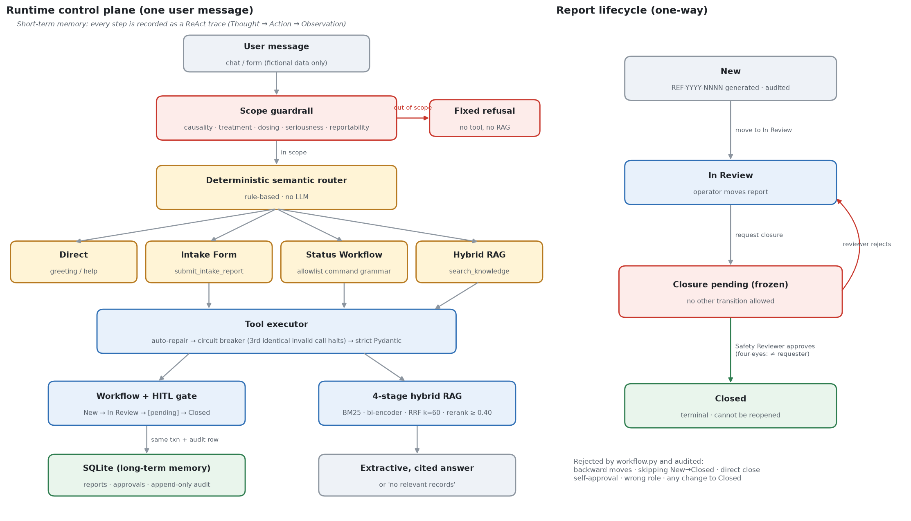
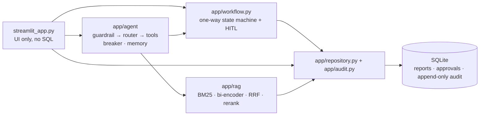

# Pharma Safety Intake & Triage Tracker

A **local, training-only** Streamlit prototype for recording *fictional* Suspected Adverse Event (AE) and Product Quality Complaint (PQC) reports. It provides:
- validated intake with context-sensitive errors;
- a filterable, searchable tracker;
- a strictly one-way `New → In Review → Closed` lifecycle with a human-in-the-loop closure gate;
- an immutable audit trail;
- a 4-stage hybrid RAG knowledge assistant;
- a deterministic agent control plane.

> ⚠️ Synthetic data only. The application never assesses causality, recommends treatment, determines regulatory reportability or makes clinical or regulatory decisions. It does not replace a pharmacovigilance system.

## Quick start

```bash
pip install -r requirements.txt
# optional neural RAG backend (MiniLM bi-encoder + MS MARCO cross-encoder):
pip install torch --index-url https://download.pytorch.org/whl/cpu
pip install -r requirements-ml.txt
python scripts/download_models.py        # one-time, the only network step

python scripts/seed_demo.py --reset      # 8 fictional reports
streamlit run streamlit_app.py           # http://localhost:8501 (bound to localhost only)
python -m pytest -q                      # 366 tests, offline, under a runtime network guard
python scripts/demo_walkthrough.py       # regenerates docs/DEMO_EVIDENCE.md
```

Without the ML extras the app automatically uses the deterministic offline encoders (`PHARMA_RAG_BACKEND=auto|neural|offline`).

## Architecture





The full step-by-step process (phases I–V, milestones, runtime flow) is in [docs/WORKFLOW.md](docs/WORKFLOW.md).

## Features → where they live

Every requirement is traced to its code and to a passing test in [docs/ACCEPTANCE.md](docs/ACCEPTANCE.md) (46 rows, checked by a test).

| Requirement | Implementation |
|---|---|
| Unique reference `REF-YYYY-NNNN` | `app/repository.py::_next_ref_id` (allocated in the insert transaction, never reused) |
| Duplicate-submission protection | SHA-256 fingerprint + UNIQUE index (`app/repository.py::fingerprint`) |
| AE / PQC categorisation, core and AE fields | `app/models.py` |
| Mandatory-field validation with context-sensitive errors and PII screening | `app/validation.py` |
| Dashboard with status/type filters and search by reference, product or batch | `streamlit_app.py` → *Dashboard* tab, `ReportRepository.list` |
| One-way `New → In Review → Closed`, HITL approval (freeze, reviewer role, four-eyes) | `app/workflow.py`, *Closure Approvals* tab |
| Append-only, metadata-only audit trail (DB triggers), including rejected actions | `app/audit.py`, `app/db.py`, *Audit Trail* tab |
| Stage 1 BM25 (k1 = 1.5, b = 0.75) | `app/rag/bm25.py` |
| Stage 2 bi-encoder, 512/64 chunks, cosine | `app/rag/dense.py`, `app/rag/chunking.py` |
| Stage 3 RRF (k = 60, top-50 + top-50) | `app/rag/fusion.py` |
| Stage 4 cross-encoder rerank (≥ 0.40, top-5) | `app/rag/rerank.py` |
| Extractive, cited answers ("no answer" when nothing passes the threshold) | `app/rag/pipeline.py` |
| Step 1: type-safe tools, strict Pydantic, regex, auto-repair | `app/agent/tools.py` |
| Step 2: dual memory (ReAct trace and SQLite) | `app/agent/memory.py` |
| Step 3: deterministic router, allowlist command grammar, scope guardrail | `app/agent/router.py`, `app/agent/orchestrator.py`, `app/agent/guardrails.py` |
| Step 4: HITL gate (the agent can only *request* closure) | `app/workflow.py`, `app/agent/tools.py` |
| Step 5: circuit breaker (trips on the 3rd identical invalid call) | `app/agent/circuit_breaker.py` |

## Governance artefacts

| Deliverable | File |
|---|---|
| Persistent guidance (Phase I) | [CLAUDE.md](CLAUDE.md) |
| Plan Mode output and approval record (Phase II) | [docs/PLAN.md](docs/PLAN.md) |
| Step-by-step workflow (Phases I–V) | [docs/WORKFLOW.md](docs/WORKFLOW.md), [docs/workflow.png](docs/workflow.png) |
| Requirements traceability | [docs/ACCEPTANCE.md](docs/ACCEPTANCE.md) |
| Review skill (Phase IV) | [.claude/skills/pharma-intake-review/](.claude/skills/pharma-intake-review/SKILL.md) · evidence: [docs/SKILL_REVIEW_EVIDENCE.md](docs/SKILL_REVIEW_EVIDENCE.md) |
| PostToolUse hook (Phase V) | [.claude/settings.json](.claude/settings.json), [.claude/hooks/log_edit_event.py](.claude/hooks/log_edit_event.py) → `logs/agent_edit_audit.jsonl` |
| Test suite | [tests/](tests/) |
| Demonstration evidence | [docs/DEMO_EVIDENCE.md](docs/DEMO_EVIDENCE.md) (scripted) · [docs/UI_TEST_GUIDE.md](docs/UI_TEST_GUIDE.md) (manual, 40 checks) |
| Defense and reflection | [docs/REFLECTION.md](docs/REFLECTION.md) |

## Known limitations (training prototype)

- **No authentication.** The operator code and role are self-declared in the sidebar. The four-eyes rule compares those codes, so one person could request closure as `OP-01` and approve it as `OP-02`. This is acceptable for a single-user local demo, but production needs SSO and server-side roles (see [docs/REFLECTION.md](docs/REFLECTION.md) §5).
- **Rule-based guardrails** catch known phrasings of causality, treatment, seriousness and reportability requests. A 128-case corpus covers them, and clinical questions are default-deny unless phrased as a records search. Still, no rule set is exhaustive. The extractive RAG design means an unrefused query can still only return recorded text, never advice.
- **SQLite triggers** make the audit table append-only against application code, not against someone with file access to the DB.
- **The hook only covers edit tools.** The PostToolUse hook logs edits made through the Edit/Write/MultiEdit/NotebookEdit tools. File changes made via shell commands are not captured.
- **Duplicate detection is exact.** Content that differs only in case or whitespace counts as a duplicate. Genuinely different wording of the same event is not detected.

## Demo walkthrough (UI)

For the full 40-check script, see [docs/UI_TEST_GUIDE.md](docs/UI_TEST_GUIDE.md). The short version:

1. Sidebar: operator `OP-01`, role *Intake Operator*.
2. **New Intake**: click *Save report* with every field empty to see all the errors. Enter a fictional AE (e.g. `Zentrovax 50 mg tablets`, `LOT-88392`, event "difficulty breathing") and a PQC. Click *Save* twice to see the duplicate warning.
3. **Dashboard**: filter or search (`lot-88392`), select a report, then *Move to In Review* and *Request closure*. The report freezes.
4. Sidebar: change to `OP-07` / *Safety Reviewer*. In **Closure Approvals**, tick the confirmation and click *Approve closure*.
5. **Knowledge Assistant**: ask *"reports of shortness of breath for LOT-88392"* and open the four stage tabs and the grounded prompt. Then try:
   - *"move REF-2026-0004 to in reveiw"* to see auto-repair;
   - *"send REF-2026-0004 back to new"* to see the one-way lifecycle;
   - *"did the drug cause it?"* to see the guardrail.
6. **Audit Trail**: every action, including rejected ones, is listed with actor, role and status change. The hook log is in the expander.
