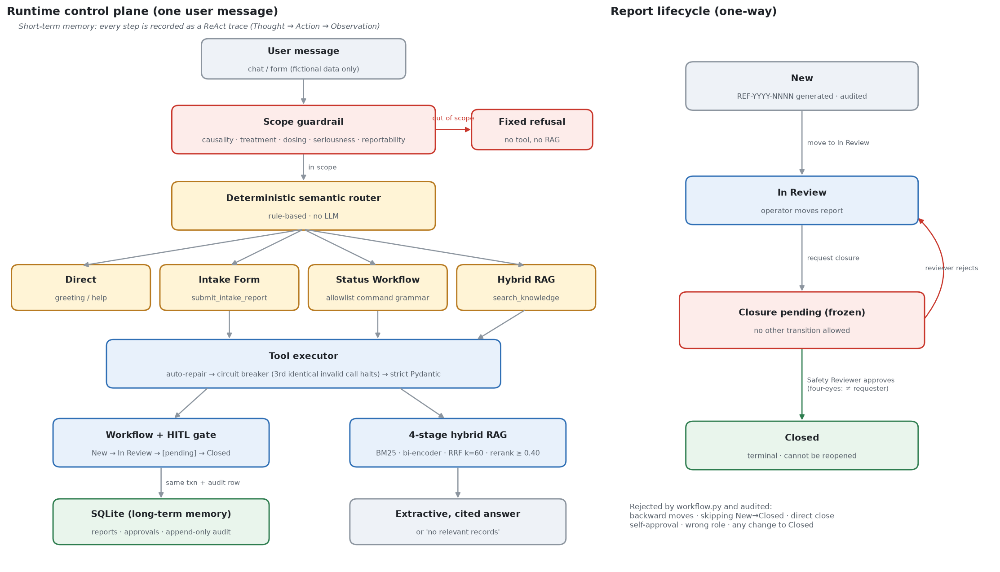
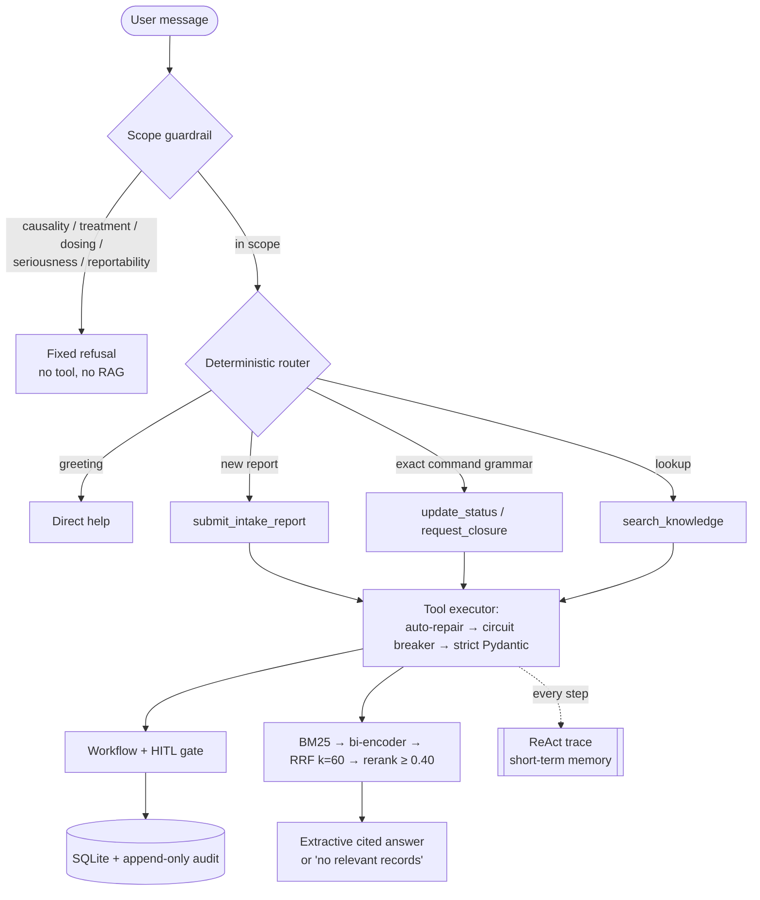
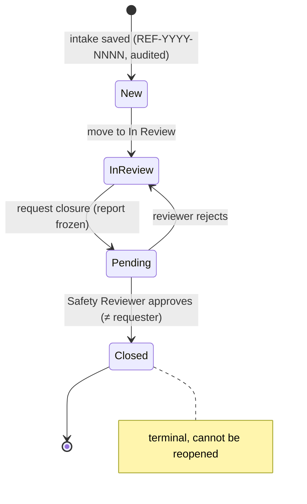

# Project Workflow: Step by Step

How the five governance phases were carried out for this project, with the output of each step and the check that proves it was done.



*(Regenerate with `python scripts/make_workflow_diagram.py`; requires `matplotlib`, which is needed only for this diagram.)*

## Phase I: Persistent guidance

| Step | Output | Done when |
|---|---|---|
| 1. Write the root contract **before any code** | [`CLAUDE.md`](../CLAUDE.md): scope boundaries, data rules, layer map, coding and testing conventions, agent workflow | `test_claude_md_has_required_sections` passes |

## Phase II: Architectural planning (Plan Mode)

| Step | Output | Done when |
|---|---|---|
| 2. Enter Plan Mode, inspect the (empty) workspace, and ask the one blocking question (neural vs offline RAG backend) | User decision: neural by default, with an offline fallback | recorded in the plan header |
| 3. Write the blueprint: layout, milestones A–G, tests, verification | [`docs/PLAN.md`](PLAN.md) | approved via ExitPlanMode; approval record in the plan |
| 4. Track deviations during the build | "Deviations during implementation" section in the plan | `test_plan_is_approved_with_signature_line` passes |

## Phase III: Incremental construction

The layers were built in milestone order, as the hook's edit timeline in `logs/agent_edit_audit.jsonl` shows. The "Done when" column below gives each milestone's acceptance check as it stands now. In practice, the pytest suite was written after the core layers (A–F) were in place, and in between each layer was verified with scripted smoke runs, for example the offline and neural RAG checks before the UI was built. A stricter process would write each milestone's tests before moving on.

| Milestone | Scope | Done when |
|---|---|---|
| **A. Skeleton and governance** | PostToolUse hook first (so every later edit is logged), `config.py`, requirements, app shell | the hook writes its first lines to `logs/agent_edit_audit.jsonl` |
| **B. Intake form and schemas** | enums, `IntakeReport` (batch regex, date rules, AE-only fields, `extra="forbid"`), PII screening, context-sensitive errors | `tests/test_validation.py` green |
| **C. Validation and persistence** | SQLite schema, append-only audit triggers, reference allocation and audit row in one transaction, duplicate fingerprint | `tests/test_storage.py`, `tests/test_edge_cases.py` green |
| **D. Dashboard and lifecycle** | filters and search, one-way state machine, HITL closure (freeze, reviewer role, four-eyes) | `tests/test_workflow.py` (3×3 transition matrix) green |
| **E. Hybrid RAG** | BM25 → bi-encoder → RRF → calibrated cross-encoder → extractive, cited answer | `tests/test_rag.py` green, including the neural backend |
| **F. Agent control plane** | strict tools with auto-repair, circuit breaker, dual memory, router, guardrails | `tests/test_agent.py`, `tests/test_guardrail_corpus.py` green |
| **G. Evidence** | seed data, demo walkthrough, docs | `docs/DEMO_EVIDENCE.md` regenerated |

## Phase IV: Specialised review skill

| Step | Output | Done when |
|---|---|---|
| 5. Create the skill | [`.claude/skills/pharma-intake-review/`](../.claude/skills/pharma-intake-review/SKILL.md): `SKILL.md`, 4 checklists, `scripts/static_checks.py` | `test_review_skill_structure` passes |
| 6. Invoke it on the codebase | an independent reviewer agent followed `SKILL.md` verbatim | round 1 report: REJECT (1 BLOCKER, 4 MAJOR) |
| 7. Fix, re-verify, repeat | 3 rounds; structural redesign of the guardrail and the status commands | [`docs/SKILL_REVIEW_EVIDENCE.md`](SKILL_REVIEW_EVIDENCE.md); every finding is pinned by a test |

## Phase V: Deterministic governance hook

| Step | Output | Done when |
|---|---|---|
| 8. Register the hook | [`.claude/settings.json`](../.claude/settings.json): PostToolUse, matcher `Edit\|Write\|MultiEdit\|NotebookEdit` | `test_hook_registered_for_edit_tools` passes |
| 9. Log metadata only | [`log_edit_event.py`](../.claude/hooks/log_edit_event.py) writes `ts_utc, event, session_id, tool_name, file_path, content_bytes, success` | `tests/test_hook.py`: secret text never reaches the log, and the same input gives the same record |

## Verification and delivery

```bash
python -m pytest -q                    # full suite, offline; runtime network guard active
python .claude/skills/pharma-intake-review/scripts/static_checks.py
python scripts/demo_walkthrough.py     # regenerates docs/DEMO_EVIDENCE.md
python scripts/seed_demo.py --reset && streamlit run streamlit_app.py
```

Then run the manual walkthrough in [`docs/UI_TEST_GUIDE.md`](UI_TEST_GUIDE.md), and check that [`docs/ACCEPTANCE.md`](ACCEPTANCE.md) shows every row as Done.

## Runtime flow (one user message)



## Report lifecycle (one-way)



Everything else is rejected by `app/workflow.py` and written to the audit trail: backward moves, skipping (New → Closed), a direct close without approval, self-approval, approval by the wrong role, and any change to a Closed report.
